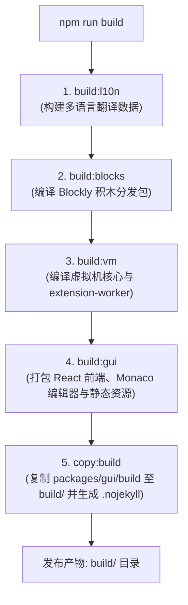

# 🚀 OpenBlock 图形化编程平台

OpenBlock 是一个轻量、高效、面向创客教育与嵌入式硬件的独立图形化编程平台。

---

## 📖 历史背景与架构演进

1. **纯粹独立形态的回归**  
   OpenBlock 本身是由四个核心子包构成的完整、独立的图形化交互系统：
   - `openblock-gui`（前端界面与工作区）
   - `openblock-blocks`（积木引擎与渲染器）
   - `openblock-vm`（执行虚拟机与硬件调度）
   - `openblock-l10n`（多语言国际化包）  
   在以往的合并过渡期中，曾引入过一个外层 iframe 门户外壳（`apps/portal`），将 GUI 强行包裹在 iframe 内运行。这种包装造成了双层滚动条、窗口拖拽事件穿透困难、样式和交互冗余笨拙。本项目彻底剥离了所有外层 iframe 外壳，让 OpenBlock GUI 作为原生独立的 Web 应用与桌面应用直接运行。

2. **从历史 OBS 部署到现代化 GitHub Pages 托管**  
   在历史工程（如 commit `303707f7` 的 Makefile）中，OpenBlock 的发布流程是手动执行 Makefile 脚本：
   ```makefile
   deploy-obs:
       cd openblock-gui && npm run build
       cp -r openblock-gui/build/* build
       obsutil cp build obs://txd-xmu -r -flat -f
   ```
   这种方式需要配置本地 `obsutil` 工具及访问密钥，流程繁琐且依赖特定云存储。现在，本项目全面拥抱现代化的 **GitHub Pages + GitHub Actions** 自动化工作流：
   - 每一次向 `main` 分支推送代码，GitHub Actions 会自动执行 `npm ci && npm run build`；
   - 根目录构建产物 `build/` 自动包含 `.nojekyll` 标识，经由 `actions/upload-pages-artifact@v3` 和 `actions/deploy-pages@v4` 一键上线；
   - 彻底淘汰人工或脚本上传 OBS，全球 CDN 自动分发，零维护成本。

---

## 🏗️ 目录结构与模块说明

```text
open-block/
├── .github/
│   └── workflows/
│       ├── pages.yml         # GitHub Pages 自动化构建与部署
│       └── desktop.yml       # 多平台（Windows/Linux/macOS）桌面安装包构建
├── packages/
│   ├── blocks/               # Blockly 积木定义与图形化组件
│   ├── gui/                  # React 前端主界面、Monaco 代码编辑器与菜单栏
│   ├── l10n/                 # 国际化语言包与本地化数据提取
│   └── vm/                   # 积木执行虚拟机、设备扩展支持与 Worker
├── desktop/                  # Tauri 2 原生桌面外壳与硬件通信服务 (Rust)
│   ├── src-tauri/
│   │   ├── Cargo.toml
│   │   ├── tauri.conf.json   # 桌面配置，指向 ../build 前端资源
│   │   └── src/              # 原生无边框窗口控制器与硬件 Bridge
│   └── README.md
├── build/                    # 根目录完整静态构建输出（由 npm run build 生成）
├── package.json              # 根目录 npm workspaces 配置与主控制脚本
├── package-lock.json         # 依赖版本锁定
└── .gitignore                # 忽略构建产物与依赖缓存
```

---

## 🛠️ 本地开发环境要求

- **Node.js**: `>= 24.0.0`
- **npm**: `>= 11.0.0`
- **Rust / Cargo** (仅开发桌面端需要): 最新稳定版 `stable`

---

## 💻 本地快速开始

### 1. 安装依赖

本项目采用原生 **npm workspaces** 管理依赖关系，执行一次 `npm ci` 即可完成根目录与所有子包的依赖对齐与本地软链接：

```bash
npm ci
```

### 2. 启动前端开发服务器

启动 `openblock-gui` 的 Webpack 开发热更新服务器（默认服务运行于 `http://localhost:8601`）：

```bash
npm start
```

### 3. 完整构建与本地静态预览

一键构建全部子模块并聚合至根目录 `build/`：

```bash
# 执行完整构建流程（l10n -> blocks -> vm -> gui -> copy:build）
npm run build

# 使用内置轻量 HTTP 服务器预览生产构建（端口 8080）
npm run serve
```

访问 `http://localhost:8080` 即可检验纯净独立的 OpenBlock 编辑器。

---

## ⚙️ 构建流程详解 (`npm run build`)

`npm run build` 会按严格的拓扑顺序执行各子包的编译：



1. **`build:l10n`**: 提取并编译各类积木与界面的语言翻译文件。
2. **`build:blocks`**: 生成 CommonJS 和 Web UMD 格式的 `vertical.js` 与 `horizontal.js`。
3. **`build:vm`**: 编译运行核心，输出 Web/Node 双端兼容包并打包出多线程 `extension-worker.js`。
4. **`build:gui`**:
   - 提取 Monaco 代码高亮组件；
   - 引入 blocks 静态媒体资源（`static/blocks-media`）；
   - 引入 vm 产出的 `extension-worker.js`；
   - 采用 `concatenateModules: false` 规避 Terser 混淆 Blockly 包装语法时的兼容性问题；
   - 产出无缝全屏运行的 `index.html`。
5. **`copy:build`**: 将最新编译的 `packages/gui/build/*` 一键同步到项目根目录的 `build/` 下，并自动生成 `.nojekyll` 文件。

---

## 🖥️ 桌面端应用 (`desktop`)

OpenBlock Desktop 基于 **Tauri 2** 架构构建，兼具轻量内存占用与原生硬件连接能力：

- **无边框原生集成**：主窗口采用无边框设计，菜单栏顶层直接集成最小化、最大化/还原、关闭控制按键与窗口拖动区域，在桌面环境下自动注入 `.native-desktop` 类进行样式激活。
- **配置指向**：`desktop/src-tauri/tauri.conf.json` 中的 `frontendDist` 直接消费 `../build` 目录，前端构建与桌面应用完全解耦。
- **本地桌面调试**：
  ```bash
  npm run desktop:dev
  ```
- **编译桌面安装包**：
  ```bash
  npm run desktop:build
  ```
- **检查桌面端代码**：
  ```bash
  npm run check:desktop
  ```

---

## 🌐 CI/CD 自动化流水线

### 1. GitHub Pages 自动部署 (`.github/workflows/pages.yml`)
- **触发条件**：向 `main` 分支的 push 事件或手动触发（`workflow_dispatch`）。
- **执行内容**：
  1. 检出仓库并设置 Node.js 24 环境；
  2. 运行 `npm ci` 安装依赖；
  3. 执行 `npm run build` 生成干净的 `build/` 静态站点；
  4. 校验 `.nojekyll` 存在（防止 GitHub Pages 忽略以下划线开头的文件）；
  5. 自动化上传 Pages Artifact 并发布上线。

### 2. 桌面端全平台 Release 构建 (`.github/workflows/desktop.yml`)
- **触发条件**：推送 tag（如 `v2.5.0` 或 `desktop-v2.5.0`）。
- **执行内容**：并行在 `windows-latest`、`ubuntu-22.04`、`macos-latest` 三大操作系统矩阵中构建原生安装程序（`.exe`、`.deb`、`.dmg`），构建完成后自动创建 GitHub Release 并附加安装包。

---

## 📄 开源许可证

本项目各子组件遵循各自的开源许可证（BSD-3-Clause / Apache-2.0）。详细信息请参见各子包目录下的 LICENSE 文件。
