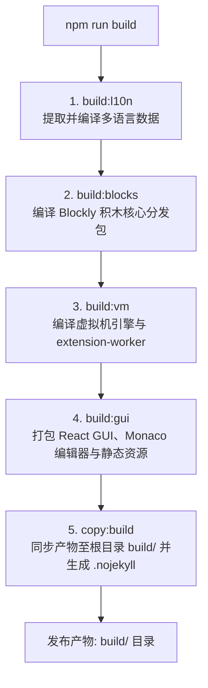

# 🚀 OpenBlock

[](https://github.com/BUG423/esp32-openblock/actions/workflows/pages.yml)
[](https://github.com/BUG423/esp32-openblock/actions/workflows/desktop.yml)
[](https://nodejs.org/)
[](LICENSE)
[](https://tauri.app/)

> 轻量、高效、面向创客教育与嵌入式硬件（ESP32 / Arduino / Micro:bit）的图形化编程平台。

---

## ✨ 核心特性

- **🧩 图形化积木编程**
  - 基于 Blockly 深度定制的积木交互系统，支持拖拽编程与实时语法校验。
  - 侧边栏类别与工作区无缝贴合，提供纯净沉浸的积木搭建体验。
- **⚡ 双模式运行架构**
  - **实时模式 (Real-time)**：积木与硬件实时双向交互通信，即刻查看运行反馈。
  - **上传模式 (Upload)**：一键将积木转换为原生代码并烧录至微控制器。
- **💻 代码同步与编辑器**
  - 内嵌 Monaco Editor 工业级代码编辑器，实时生成 C++ / MicroPython 代码。
  - 支持积木视图与代码视图自由切换与对照调试。
- **🖥️ 全平台跨端支持**
  - **Web 端**：纯静态前端部署，支持全球 CDN 极速访问与离线缓存。
  - **桌面端**：基于 Tauri 2 构建，轻量无边框原生窗口，原生集成硬件串口与通信。
- **🌍 国际化与本地化**
  - 内置完善的多语言支持体系（简体中文、英语等），语言切换即时生效。

---

## 🏗️ 项目架构

本项目采用 npm Workspaces 单体仓库（Monorepo）结构统一管理：

```text
open-block/
├── packages/
│   ├── blocks/               # Blockly 积木定义、渲染器与自定义块库
│   ├── gui/                  # React 前端主界面、Monaco 编辑器与交互容器
│   ├── l10n/                 # 国际化语言包与本地化翻译资源
│   └── vm/                   # 虚拟机执行引擎、设备扩展与 Worker 线程
├── desktop/                  # Tauri 2 原生跨平台桌面外壳 (Rust)
│   └── src-tauri/            # 原生窗口控制器与硬件 Bridge
├── build/                    # 生产环境编译产物输出目录
├── .github/workflows/        # 自动化部署 (Pages) 与全平台桌面构建流水线
└── package.json              # Monorepo 依赖管理与构建脚本
```

---

## 🛠️ 环境要求

- **Node.js**: `>= 24.0.0`
- **npm**: `>= 11.0.0`
- **Rust / Cargo** (仅构建桌面端应用需要): 最新稳定版 `stable`

---

## 💻 快速开始

### 1. 安装依赖

通过 npm Workspaces 一键初始化项目及所有子模块依赖：

```bash
npm ci
```

### 2. 启动开发服务器

启动 Webpack 热更新开发服务器（默认服务运行于 `http://localhost:8601`）：

```bash
npm start
```

### 3. 构建与本地预览

执行全模块拓扑构建，将完整产物输出至根目录 `build/`：

```bash
# 完整编译 (l10n -> blocks -> vm -> gui -> copy:build)
npm run build

# 使用内置 HTTP 服务器预览生产构建 (http://localhost:8080)
npm run serve
```

---

## ⚙️ 构建流程

`npm run build` 会按严格的拓扑依赖顺序分步编译各个子包：



---

## 🖥️ 桌面端应用

OpenBlock 桌面端基于 **Tauri 2** 构建，具有极低资源占用与原生硬件连接支持：

| 操作 | 对应命令 | 说明 |
| :--- | :--- | :--- |
| **桌面端本地调试** | `npm run desktop:dev` | 启动原生桌面窗口并连接开发服务 |
| **编译桌面安装包** | `npm run desktop:build` | 编译跨平台独立桌面安装程序 |
| **桌面端代码检查** | `npm run check:desktop` | 检查 Tauri/Rust 后端编译状态 |

---

## 🚀 持续集成与部署 (CI/CD)

- **GitHub Pages 部署 (`pages.yml`)**  
  向 `main` 分支提交代码后，流水线将自动运行依赖安装、拓扑构建并部署至 GitHub Pages 静态托管站点。
- **全平台发布构建 (`desktop.yml`)**  
  推送版本标签（如 `v2.5.0`）时，流水线将并行在 Windows、Linux 与 macOS 环境下编译桌面安装包（`.exe`、`.deb`、`.dmg`）并自动发布 GitHub Release。

---

## 📄 开源许可证

本项目各子组件遵循各自的开源许可证（BSD-3-Clause / Apache-2.0）。详细信息请参见各子模块目录下的 LICENSE 文件。
