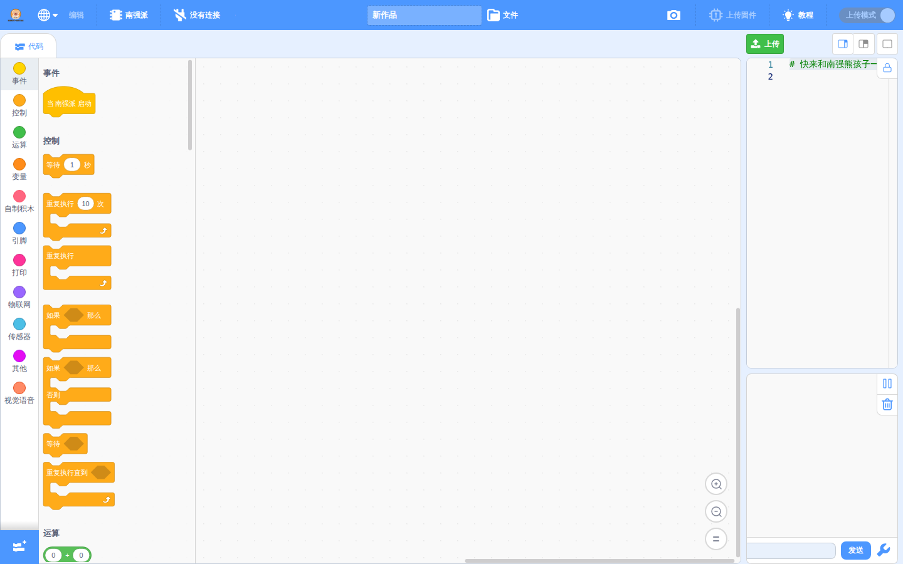
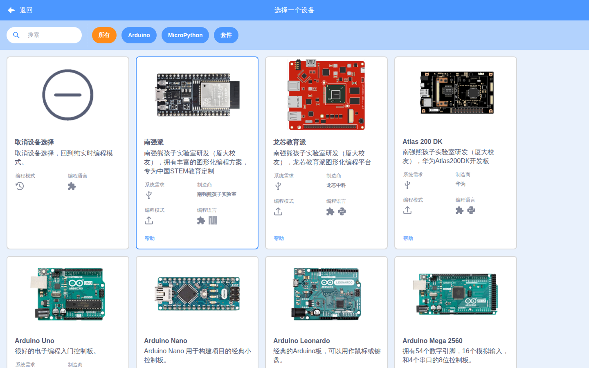

# 🚀 OpenBlock

> **OpenBlock** 是一个面向创客教育、嵌入式系统与人工智能教育的开源图形化编程平台。无需在本地安装复杂的工具链或编译器，即可在现代浏览器中直接进行积木编程、代码对照与硬件交互。

---

## 🌐 在线体验

平台已完成 GitHub Pages 云端自动化托管，即开即用：

👉 **[点击直接进入 OpenBlock 在线编程平台](https://bug423.github.io/esp32-openblock/)**

---

## 🖼️ 平台界面预览

| 积木编排与 MicroPython 代码实时联动 | 主流硬件矩阵（ESP32 / 龙芯 / Atlas 200 DK） |
| :---: | :---: |
|  |  |

---

## 🖥️ 桌面端客户端 (Desktop)

除了免安装的 Web 在线版外，OpenBlock 还提供基于 **Tauri 2 + Rust** 构建的跨平台桌面端客户端：

- **⚡ 轻量原生体验**：直接利用系统原生 Webview 渲染，相比传统框架体积更小、内存占用极低、启动迅速。
- **🔌 原生硬件级直连**：内置 Rust 编写的高性能通信中间件（`openblock-link-rs`），原生支持 USB 串口自动识别、实时通信与固件高速直连烧录。
- **📥 下载与使用**：前往仓库 **[Releases 发布页面](https://github.com/BUG423/esp32-openblock/releases)** 即可下载适用于 Windows / Linux / macOS 的独立安装程序与运行文件。

---

## 🎯 支持硬件与核心积木

平台原生支持多款主流嵌入式芯片与 AI 边缘计算平台：

- **ESP32（南强派 / 基础 ESP32）**
  - **引脚控制**：数字输入输出、PWM、ADC 模拟采集、DAC 输出
  - **串口与打印**：串口数据输出与监控
  - **物联网 (IoT)**：WiFi 无线网络接入、MQTT 物联网云平台连接
  - **传感器库**：温湿度、测距、光照等外设驱动积木
  - **视觉与语音**：AI 图像识别交互与语音识别控制
  - **系统与杂项**：延时控制、硬件定时器、I2C/SPI 总线控制
- **龙芯 (Loongson / Loongbian)**
  - 龙芯教育开发板及自主指令集微控制器支持
- **Atlas 200 DK**
  - 华为昇腾边缘 AI 运算套件交互支持

---

## ✨ 核心能力

- **🧩 拖拽式积木编程**：基于成熟的 Blockly 引擎，零门槛进行逻辑与硬件控制编排。
- **💻 积木与代码实时对照**：拖拽积木的同时自动生成标准的 MicroPython / C++ 代码。
- **🔌 双模式开发**：
  - **实时调试模式**：积木与开发板建立实时在线通信，即时验证算法逻辑。
  - **代码生成与脱机运行**：生成完整可烧录脚本，脱机独立运行。
- **🌍 完整国际化**：内置全中文交互界面，专为创客与教学场景深度适配。

---

## 📄 知识产权与开源协议

本项目遵循 **[Creative Commons Attribution-NonCommercial-NoDerivatives 4.0 International (CC BY-NC-ND 4.0)](https://creativecommons.org/licenses/by-nc-nd/4.0/)** 严格非商业开源许可：

- ❌ **严禁商用**：任何个人或组织不得将本项目源码、编译产物或衍生版本用于任何商业盈利目的。
- ❌ **禁止演绎与分发修改版**：未经授权不得散布基于本项目修改后的二次分发版本。
- 🔒 **权利保留**：作者保留对本平台代码与架构的所有版权与法律追责权利。
